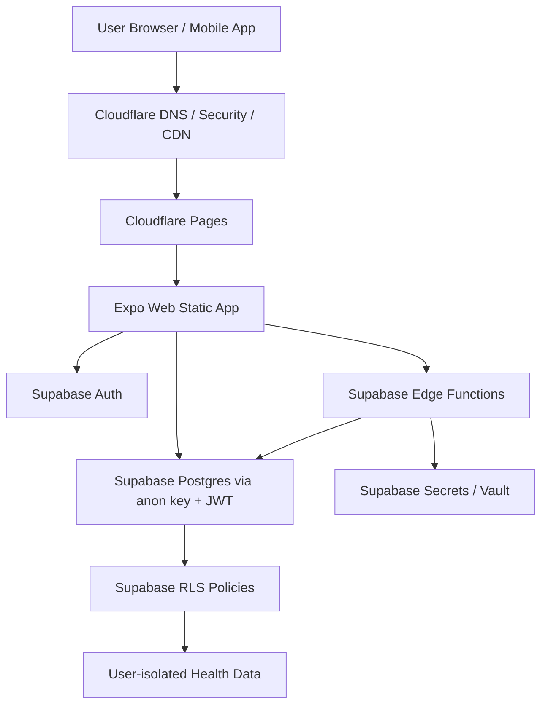

# Zaad 3-Tier Architecture

This is the recommended production structure for Zaad on Cloudflare Pages and
Supabase.

## Tier 1: Presentation

| Item | Choice |
|---|---|
| Hosting | Cloudflare Pages |
| DNS / CDN / Security | Cloudflare |
| App | Expo Web static export |
| Build command | `npm run build` |
| Output directory | `dist` |
| SPA fallback | `dist/_redirects` with `/* /index.html 200` |
| Public env vars | `EXPO_PUBLIC_SUPABASE_URL`, `EXPO_PUBLIC_SUPABASE_ANON_KEY` |
| Custom domain | Cloudflare DNS after moving Namecheap nameservers |

Responsibilities:

| Responsibility | Notes |
|---|---|
| Render app UI | Login, register, onboarding, dashboard, profile, reports |
| Store user session | Supabase session in browser storage on web |
| Call auth/data APIs | Uses Supabase anon key and user JWT |
| Never store secrets | No service role key, SMTP key, or encryption key in the client |

## Tier 2: Application

| Item | Choice |
|---|---|
| Auth provider | Supabase Auth |
| Server logic | Supabase Edge Functions |
| Sensitive operations | Supabase Edge Functions only |
| Secrets location | Supabase Vault or Supabase Edge Function secrets |

Responsibilities:

| Responsibility | Notes |
|---|---|
| Email signup/login | Supabase Auth email/password |
| Password hashing | Handled by Supabase Auth using bcrypt |
| Password reset | Supabase recovery flow |
| OAuth | Google/Apple providers if enabled |
| Sensitive processing | Lab report parsing, OCR cleanup, AI calls, encryption/decryption through Supabase Edge Functions |
| Rate limiting | Cloudflare WAF/rate limiting for public endpoints |

Rules:

| Rule | Why |
|---|---|
| Use anon key only in the app | It is designed for public clients with RLS |
| Keep service role server-only | It bypasses RLS and can expose all data |
| Put AI/API provider keys only in server functions | Prevents browser extraction |
| Do not hash passwords manually in the app | Supabase Auth already hashes safely |
| Do not put sensitive app logic in Cloudflare Pages | Pages should serve the frontend only |

## Tier 3: Data

| Item | Choice |
|---|---|
| Database | Supabase Postgres |
| Authentication users | `auth.users` |
| App data | `public` schema tables |
| Isolation | Row-Level Security |
| Storage | Supabase Storage, if files are needed |
| Extra encryption | Server-side column encryption for sensitive health/report fields |

Responsibilities:

| Responsibility | Notes |
|---|---|
| User isolation | Every user reads/writes only their rows |
| Health profile data | Linked to authenticated user |
| Meals and plans | User-owned rows, public reference data separated |
| Lab reports | Private rows, sensitive fields encrypted when possible |
| Public content | Recipes/reference foods can be read-only public |

Baseline RLS model:

| Table type | Required policy |
|---|---|
| User-owned tables | `user_id = auth.uid()` |
| Profile-owned tables | `profile_id` must belong to `auth.uid()` |
| Public reference tables | Public read, admin/server write |
| Files/storage | Path or metadata must match authenticated user |

## Request Flow

| Step | Flow |
|---|---|
| 1 | User opens `https://example.com/login` |
| 2 | Cloudflare Pages serves the Expo app from `dist` |
| 3 | User signs in with email/password through Supabase Auth |
| 4 | Supabase returns a JWT session |
| 5 | App reads/writes Supabase data using the anon key + JWT |
| 6 | Postgres RLS filters rows so the user only sees their own data |
| 7 | Sensitive server-only actions go through Supabase Edge Functions |

## Production Checklist

| Area | Required action |
|---|---|
| Cloudflare Pages | Set build command to `npm run build` |
| Cloudflare Pages | Set output directory to `dist` |
| Cloudflare Pages | Set `NODE_VERSION=22.13.0` |
| Cloudflare Pages | Add Supabase public env vars |
| Namecheap | Move nameservers to Cloudflare |
| Supabase Auth | Enable Email provider |
| Supabase Auth | Set production Site URL |
| Supabase Auth | Add production redirect URLs |
| Supabase Database | Enable RLS on app tables |
| Supabase Database | Apply ownership policies |
| Secrets | Keep service role and provider keys out of the client |
| Supabase Edge Functions | Store sensitive API keys in Supabase secrets |

## Recommended Tiers by Environment

| Environment | Purpose | Domain | Database |
|---|---|---|---|
| Development | Local testing | `localhost` | Supabase development project |
| Staging | Pre-production testing | `staging.example.com` | Supabase staging project |
| Production | Real users | `example.com` | Supabase production project |

Use separate Supabase projects for staging and production when real health data is
involved. This keeps test users, test files, and migrations isolated from live
users.

## Environment Build Matrix

| Environment | Cloudflare environment | Build command | Branch | Domain | Env template |
|---|---|---|---|---|---|
| Development | Local machine | `npm run build:dev` | Any local branch | `http://localhost:8081` or Expo local URL | `.env.development.example` |
| Staging | Preview | `npm run build:staging` | `staging` or pull request branches | `staging.example.com` | `.env.staging.example` |
| Production | Production | `npm run build:prod` | `main` | `example.com` | `.env.production.example` |

## Environment Variables

| Variable | Development | Staging | Production | Secret? |
|---|---|---|---|---|
| `APP_ENV` | `development` | `staging` | `production` | No |
| `NODE_VERSION` | `22.13.0` | `22.13.0` | `22.13.0` | No |
| `EXPO_PUBLIC_SUPABASE_URL` | Dev Supabase URL | Staging Supabase URL | Production Supabase URL | No |
| `EXPO_PUBLIC_SUPABASE_ANON_KEY` | Dev anon key | Staging anon key | Production anon key | No |
| `EXPO_PUBLIC_API_URL` | Local API URL | Staging API URL | Production API URL | No |
| `SUPABASE_SERVICE_ROLE_KEY` | Server only | Server only | Server only | Yes |
| AI/provider API keys | Server only | Server only | Server only | Yes |

## Supabase Auth URLs by Environment

| Environment | Site URL | Redirect URLs |
|---|---|---|
| Development | `http://localhost:8081` | `http://localhost:8081/**`, `zaad://**` |
| Staging | `https://staging.example.com` | `https://staging.example.com/**`, `zaad://**` |
| Production | `https://example.com` | `https://example.com/**`, `https://www.example.com/**`, `zaad://**` |

## Promotion Flow

| Step | Action |
|---|---|
| 1 | Build and test locally against the development Supabase project. |
| 2 | Merge to the staging branch or open a pull request. |
| 3 | Cloudflare Preview deploys staging with staging env vars. |
| 4 | Test signup, login, password reset, and RLS on staging. |
| 5 | Merge to `main`. |
| 6 | Cloudflare Production deploys with production env vars. |
| 7 | Run a production smoke test using a real test account. |

## Final Architecture Decision

| Layer | Decision |
|---|---|
| Frontend | Cloudflare Pages |
| Backend/Auth | Supabase |
| Sensitive functions | Supabase Edge Functions |
| Database isolation | Supabase RLS |
| DNS/Security/CDN | Cloudflare |

Cloudflare Workers are not part of the default application backend. Use them only
later for edge-specific needs such as advanced routing, request filtering, or
custom CDN behavior.
